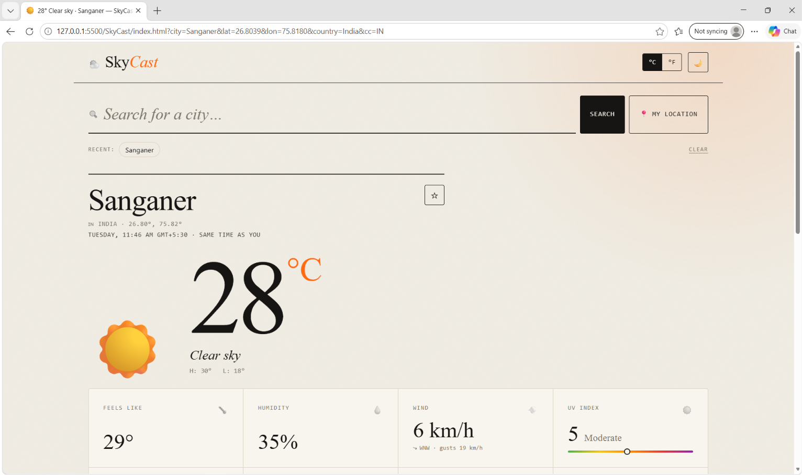
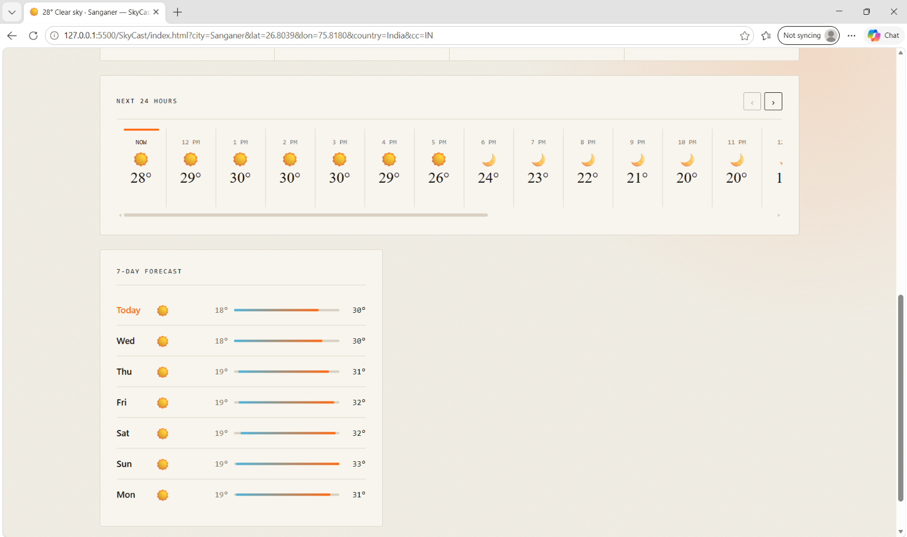

# SkyCast - Weather App

A responsive weather application built with HTML, CSS and JavaScript.

SkyCast helps users check weather information for different cities through a clean and simple interface.

## Features

- Search weather by city
- Current temperature and weather conditions
- Feels-like temperature
- Humidity and wind information
- Hourly forecast
- 7-day forecast
- Celsius and Fahrenheit toggle
- Location-based weather

## Technologies Used

- HTML5
- CSS3
- JavaScript
- Open-Meteo API

## Screenshots

### Main Dashboard



### Weather Forecast



## Run Locally

1. Clone the repository:

   ```bash
   git clone https://github.com/aryansinghtanwar16/Sky-Cast-Weather-App.git